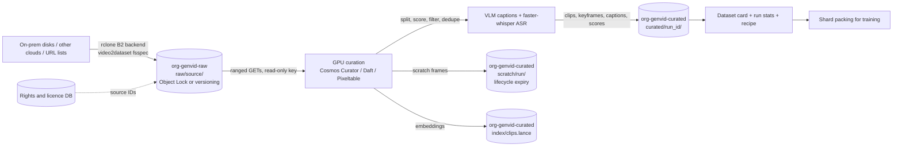

# Ingest licensed footage, then split, caption and curate a text-to-video training corpus

## Workload

Text-to-video and image-to-video teams turn licensed, partner and permissively licensed source footage into a training corpus. Scene detection cuts footage into clips; filters score aesthetics, motion, OCR text coverage, blur and safety; perceptual or embedding dedupe removes near-duplicates; VLMs and ASR write captions. Each corpus version must be traceable to the footage, recipe and run that produced it.

B2 is the system of record for raw footage and for every curated artifact. GPU compute in any cloud reads B2 over the S3 API; nothing requires copying the full corpus to each node.

## Data flow

The [shard-streaming architecture](../stream-shards-train-video-diffusion/architecture.md) picks up from the curated bucket.

## B2 zones

| Bucket | Prefix | Versioning / lifecycle | Object Lock | Purpose |
|---|---|---|---|---|
| `<org>-genvid-raw` | `raw/<source>/<batch>/` | Versioning on; no expiry while licensed | Enabled at creation, default governance retention set from licence terms | Immutable source footage with licence and consent sidecars (`<object>.license.json`) |
| `<org>-genvid-curated` | `curated/<run_id>/{clips,keyframes,captions,scores}/` | Keep; superseded runs expired only by explicit decision | Not enabled | Curated clips, keyframes, caption JSONL and score Parquet per run |
| `<org>-genvid-curated` | `index/<table>.lance/` | Keep | Not enabled | Lance clip-embedding table |
| `<org>-genvid-curated` | `runs/<run_id>/` | Keep | Not enabled | Recipe config, per-operator stats, dataset card |
| `<org>-genvid-curated` | `scratch/<run_id>/` | Lifecycle: hide after N days, delete after hide ([example](../../examples/lifecycle-scratch.json)) | Not enabled | Intermediates that must not outlive the run |

Object Lock is a bucket property with per-object or bucket-default retention, not a prefix property, so raw footage gets its own bucket. Bucket names are globally unique; replace `<org>` and expect collisions.

## Boundaries

| Stays off B2 | Where it lives | Why |
|---|---|---|
| URL frontier and download-status queue | Postgres, Redis or Spark state | Transactional, high-churn updates |
| Rights and licence database | Relational database | Authoritative, queryable, access-controlled; B2 holds only sidecar copies |
| Ray or Slurm task state | Scheduler | Not durable data |
| GPU-local decode scratch | Node NVMe | Latency-sensitive random I/O |
| In-RAM FAISS index during dedupe | Worker memory | Rebuilt per run; the durable embeddings live in Lance on B2 |
| Run-tracking database | Relational database | Queries across runs; B2 holds the per-run artifacts |

## B2 capability map

| Capability | Used | How or why not |
|---|---|---|
| S3-compatible API | Yes | All tools reach B2 at `https://s3.<region>.backblazeb2.com`, derived from the bucket region |
| Presigned URLs / CORS | No | No browser or third-party URL handoff in this workflow |
| Large-file multipart upload | Yes | Source masters and large shards; rclone and boto3-based tools handle it |
| Scoped application keys | Yes | Ingest writer, curation reader, curated writer; see below |
| Event notifications | No | Curation runs are batch-scheduled; add notifications only if ingest should trigger runs |
| Object versions | Yes | Raw bucket, so overwrites and deletes are recoverable |
| Lifecycle rules | Yes | `scratch/` only ([example](../../examples/lifecycle-scratch.json)); B2 lifecycle hides, then deletes, by prefix and age |
| SSE | Optional | SSE-B2 default encryption if policy requires it |
| Object Lock | Yes | Raw bucket default governance retention ([example](../../examples/object-lock-governance.json)) |
| Cloud Replication | Optional | Bucket-to-bucket DR copy of raw footage; not a delivery path |
| Included egress / CDN / compute partners | Indirect | GPU clusters in other clouds read B2 directly; see [pricing](https://www.backblaze.com/cloud-storage/pricing) for egress terms |
| Standard B2 vs Overdrive vs local cache | Standard | Standard B2 by default; [Overdrive](https://www.backblaze.com/cloud-storage/b2-overdrive) only if measured object throughput, not decode, limits runs; node NVMe holds per-task scratch only |

## Integration configuration

All endpoints use `https://s3.<region>.backblazeb2.com`, derived from `B2_REGION`. Never hardcode a region.

- **rclone (built-in B2 backend).** Configure a `b2` remote with an application key restricted to `<org>-genvid-raw` and `raw/`, `writeFiles` plus `listFiles`. rclone's [B2 backend docs](https://rclone.org/b2/) describe this. Use it for bulk seeding from disks and other clouds.
- **video2dataset (fsspec / s3fs).** Set the output folder to `s3://<org>-genvid-raw/raw/<source>/` and configure fsspec with `endpoint_url` under `s3.client_kwargs` as the B2 endpoint, as the README shows.
- **NVIDIA Cosmos Curator (S3 custom endpoint).** Configure `region` and `endpoint_url` in `~/.aws/credentials`, which is the only file Cosmos Curator reads ([end-user guide](https://github.com/NVIDIA/cosmos-curator/blob/main/docs/client/end-user-guide.md)). Mount that file from a secret; give it the curation-reader profile for raw input and a separate curated-writer profile for output where the pipeline allows two profiles.
- **Daft (S3 custom endpoint).** `IOConfig(s3=S3Config(endpoint_url=..., key_id=..., access_key=..., region_name=...))` per the [config API docs](https://docs.daft.ai/en/stable/api/config/).
- **Pixeltable (built-in B2 option).** Add a `[b2]` profile with the application key to `~/.aws/credentials`, set `b2_profile = "b2"` in `config.toml`, and point media destinations at `https://s3.<region>.backblazeb2.com/<bucket>/<prefix>/` ([Backblaze B2 section](https://docs.pixeltable.com/integrations/cloud-storage)).
- **LanceDB / Lance (S3 custom endpoint).** Use the [pinned connection profile](../../examples/lancedb.md) for clip embeddings in the curated bucket. It specifies the B2 endpoint, region, credentials and a Lance version whose S3 commit handler requires one writer per table. Serialize ingest, index creation, compaction and other mutations through one writer service; readers can run separately. Endpoint settings alone do not establish safe commit behavior across Lance versions.

Other curation tools that read `s3://` paths work the same way once their S3 client points at the B2 endpoint. For Ray Data `read_videos`, pass a `pyarrow.fs.S3FileSystem(endpoint_override=...)` as `filesystem` ([API reference](https://docs.ray.io/en/latest/data/api/doc/ray.data.read_videos.html)). For Data-Juicer, the [Data-Juicer sample](https://github.com/backblaze-b2-samples/data-juicer-multimodal-curation) handles B2 I/O in its app layer.

## Security

| Role | Bucket / prefix | Capabilities |
|---|---|---|
| ingest-writer | `<org>-genvid-raw` / `raw/` | `listFiles,writeFiles` |
| curation-reader | `<org>-genvid-raw` / `raw/` | `listFiles,readFiles` |
| curated-writer | `<org>-genvid-curated` / (whole bucket, or `curated/` + a separate `scratch/` key) | `listFiles,readFiles,writeFiles,deleteFiles` |
| takedown-admin | `<org>-genvid-raw` (whole bucket) | `listFiles,readFiles,deleteFiles,bypassGovernance`; audited break-glass use only |
| provisioning (admin) | account | Bucket, lifecycle and retention setup only; never in runtime |

A key scopes to one bucket, one optional prefix and a capability list ([keys docs](https://www.backblaze.com/docs/cloud-storage-application-keys)). Secrets go in a gitignored `0600` `.env` or the cluster secret store; never in recipes, notebooks or logs. Governance retention lets a privileged key override a lock; choose compliance mode only for a contractual requirement because it cannot be shortened.

## Takedown and erasure

Licences get revoked, rights holders send takedown notices, and people withdraw consent (for example a GDPR erasure request). Retention on the raw bucket must not make those deletions impossible.

- **Governance mode (this repo's default).** Deleting a locked version early needs `bypassGovernance` together with `deleteFiles`. No runtime role holds them. Use a dedicated `takedown-admin` key, kept out of pipelines, used only from an audited process that records the request, the object versions deleted and the approver.
- **Compliance mode.** No key can delete a locked version before its retention ends, and retention cannot be shortened. Do not use it for footage that contains personal data or depends on revocable licences.
- **Downstream copies.** Deleting raw footage does not remove the clips, captions, embeddings and shards built from it. The run ID and source IDs in each dataset card identify affected `curated/<run_id>/` objects and Lance rows. Rebuild or filter the next dataset version, and record the takedown in the dataset card.
- **Published outputs.** Takedowns of generated or published assets follow the legal-hold and audit process in the [moderation architecture](../moderate-review-approve-generated-video/architecture.md).

## References

- [Backblaze B2 S3-compatible API](https://www.backblaze.com/docs/cloud-storage-s3-compatible-api)
- [B2 Object Lock](https://www.backblaze.com/docs/cloud-storage-object-lock)
- [B2 lifecycle rules](https://www.backblaze.com/docs/cloud-storage-lifecycle-rules)
- [B2 application keys](https://www.backblaze.com/docs/cloud-storage-application-keys)
- [B2 pricing](https://www.backblaze.com/cloud-storage/pricing)
- Samples: [Videohash Deduplication](https://github.com/backblaze-b2-samples/videohash-deduplication), [CLIP Video Scene Search](https://github.com/backblaze-b2-samples/clip-video-scene-search), [Qwen Video Chapters](https://github.com/backblaze-b2-samples/qwen-video-chapters), [Pixeltable notebooks](https://github.com/backblaze-b2-samples/b2-pixeltable-multimodal-data), [NudeNet Video Moderation](https://github.com/backblaze-b2-samples/nudenet-video-moderation), [Whisper Subtitle Pipeline](https://github.com/backblaze-b2-samples/whisper-subtitle-pipeline), [Awesome Multimodal Data](https://github.com/backblaze-labs/awesome-multimodal-data) (curated datasets and tooling)
