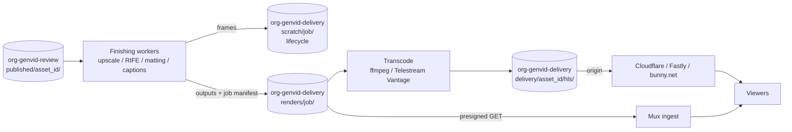

# Finish, transcode and deliver generated video through a CDN

## Workload

Many gen-video models emit short, low-resolution, low-frame-rate clips. Approved masters go through finishing passes: upscaling (Real-ESRGAN), frame interpolation (RIFE), matting (RobustVideoMatting), captions (Whisper) and per-platform cutdowns such as 9:16 shorts. Each master then fans out into an HLS ladder, posters, thumbnail sprites and WebVTT. Read traffic is heavy and repeated, so egress and duplicate copies drive cost.

B2 keeps masters, finishing outputs and delivery renditions in one place, and serves as the origin for a CDN partner. Managed video platforms fetch masters from B2 rather than becoming a second system of record.

## Data flow

## B2 zones

| Bucket | Prefix | Versioning / lifecycle | Object Lock | Purpose |
|---|---|---|---|---|
| `<org>-genvid-delivery` | `scratch/<job>/` | Lifecycle: hide, then delete ([example](../../examples/lifecycle-scratch.json)) | Not enabled | Finishing frames |
| `<org>-genvid-delivery` | `renders/<job>/` + `job.json` | Keep finished masters; expire superseded intermediates | Not enabled | Upscaled, interpolated, matted, captioned masters and cutdowns |
| `<org>-genvid-delivery` | `delivery/<asset_id>/hls/<rendition>/`, `posters/`, `sprites/`, `captions/` | Keep latest version only ([example](../../examples/lifecycle-keep-latest.json)) | Not enabled | CDN-served renditions |

A private bucket behind a signing edge app is the default. A public bucket is simpler, but every object in it becomes readable by URL. If you choose public, put only `delivery/` content in it, as a separate `<org>-genvid-public` bucket. Set `Cache-Control` through bucket info ([example](../../examples/bucket-info-cache-control.json)).

## Boundaries

| Stays off B2 | Where it lives | Why |
|---|---|---|
| CDN edge cache | CDN | Hot reads |
| Player analytics | Analytics service | Event data |
| Entitlement and auth | Auth service | Decides who gets a token |
| Finishing and transcode job queue | Queue | Dispatch |
| Mux-hosted renditions | Mux | When Mux handles playback, B2 keeps the master only |

## B2 capability map

| Capability | Used | How or why not |
|---|---|---|
| S3-compatible API | Yes | Workers, Vantage, CDN origin |
| Presigned URLs | Yes | Mux ingest; private review |
| CORS | Yes, if players fetch cross-origin | HLS players need it ([example](../../examples/cors-playback.json)) |
| Multipart upload | Yes | Long masters |
| Scoped application keys | Yes | Finishing writer, transcoder, edge signer |
| Event notifications | Optional | Trigger transcode on `renders/` upload |
| Object versions | Default | B2 keeps prior versions by default, so rewritten playlists, posters and re-renders pile up as billed storage; add a keep-latest rule ([example](../../examples/lifecycle-keep-latest.json)) |
| Lifecycle rules | Yes | `scratch/`, intermediates and keep-latest on `delivery/`; merge all rules for the bucket into one array before applying |
| SSE | Optional | SSE-B2 is transparent to signed edge reads |
| Object Lock / replication | No | Masters are retained upstream in the review bucket; add replication for DR if needed |
| Included egress / CDN partners | Yes | Backblaze does not charge download fees for egress to CDN partners such as Cloudflare, Fastly and bunny.net; see [pricing](https://www.backblaze.com/cloud-storage/pricing) |
| Standard B2 vs Overdrive vs local cache | Standard + CDN | The CDN absorbs hot reads; Overdrive does not apply to edge-cached delivery |

## Integration configuration

Origin host: `s3.<region>.backblazeb2.com`, derived from the bucket region.

- **Cloudflare (Backblaze guide).** Use a public bucket as origin, or a Worker that signs requests to a private bucket with a read-only key scoped to `delivery/` ([guide](https://www.backblaze.com/docs/cloud-storage-deliver-private-backblaze-b2-content-through-cloudflare-cdn); sample: [cloudflare-b2](https://github.com/backblaze-b2-samples/cloudflare-b2)).
- **bunny.net (Backblaze guide).** The pull-zone origin is the B2 S3 endpoint. Enable S3 Authentication with the key ID and application key for private buckets ([guide](https://www.backblaze.com/docs/cloud-storage-integrate-bunnynet-with-backblaze-b2)).
- **Fastly (Backblaze guide).** The B2 S3 endpoint is the origin, and a Compute app signs private reads ([guide](https://www.backblaze.com/docs/cloud-storage-integrate-fastly-cdn-with-backblaze-b2); sample: [fastly-b2-rust](https://github.com/backblaze-b2-samples/fastly-b2-rust)).
- **Telestream Vantage Gateway (Backblaze guide).** For source and destination, choose the NETAPP option and enter the B2 key ID, application key, S3 endpoint URL and bucket/path ([guide](https://www.backblaze.com/docs/cloud-storage-integrate-vantage-gateway-with-backblaze-b2)).
- **Mux (presigned URL ingest).** Pass a B2 presigned GET URL for the master as `inputs[].url` on [create asset](https://www.mux.com/docs/api-reference/video/assets/create-asset), with an expiry that covers Mux's download.

Transloadit writes encoding results to B2 through its [Backblaze Store Robot](https://transloadit.com/docs/robots/backblaze-store/); the [Transloadit sample](https://github.com/backblaze-b2-samples/b2-transloadit-example) gives it a write-only key.

## Security

| Role | Bucket / prefix | Capabilities |
|---|---|---|
| finishing-writer | `<org>-genvid-delivery` | `listFiles,readFiles,writeFiles` |
| transcoder | `<org>-genvid-delivery` | `listFiles,readFiles,writeFiles` |
| edge-signer | `<org>-genvid-delivery` / `delivery/` | `readFiles` |
| mux-signer | `<org>-genvid-delivery` / `renders/` | `readFiles` |

The finishing workers also need read access on `published/` in the review bucket. Give them a separate read-only key. Keep the edge signer's key in the CDN's secret store. On takedown, delete the renditions and purge the CDN cache.

## References

- [B2 pricing and egress terms](https://www.backblaze.com/cloud-storage/pricing)
- [B2 CORS rules](https://www.backblaze.com/docs/cloud-storage-cross-origin-resource-sharing-rules)
- [B2 lifecycle rules](https://www.backblaze.com/docs/cloud-storage-lifecycle-rules)
- Samples: [AI Video Upscaler & Restore](https://github.com/backblaze-b2-samples/ai-video-upscaler-restore), [RIFE Frame Interpolation](https://github.com/backblaze-b2-samples/rife-frame-interpolation-pipeline), [Whisper Subtitle Pipeline](https://github.com/backblaze-b2-samples/whisper-subtitle-pipeline), [Remotion Promo Video Pipeline](https://github.com/backblaze-b2-samples/remotion-promo-video-pipeline), [AI Shorts Generator](https://github.com/backblaze-b2-samples/ai-shorts-generator), [FFmpeg HLS VOD Transcoder](https://github.com/backblaze-b2-samples/ffmpeg-hls-vod-transcoder), [Transloadit + bunny.net](https://github.com/backblaze-b2-samples/b2-transloadit-example)
