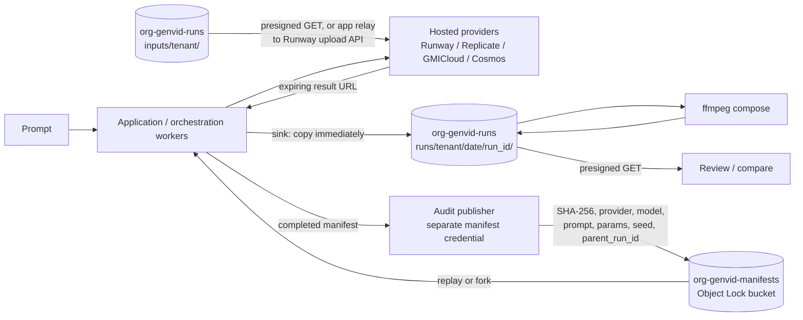

# Generate video across hosted model APIs and keep every output with a provenance manifest

## Workload

A product turns a prompt into a short video. It writes a storyboard, generates keyframe images, fans those out to hosted image-to-video or text-to-video models (Runway, Replicate-hosted models, Kling or Wan through GMICloud, NVIDIA Cosmos), adds TTS narration and music, and composes the result with ffmpeg. Providers return result URLs that expire, and each generation is billed. Teams compare providers, re-run or fork promising runs, and answer disclosure and takedown requests.

B2 is the provider-neutral record. Application workers copy every intermediate and final asset into B2 as soon as the provider returns it, alongside a manifest that records what produced it. A separate writer copies approved manifests into the Object Lock bucket when retention is required.

## Data flow



```mermaid
sequenceDiagram
  participant App
  participant B2
  participant Prov as Provider API
  App->>B2: PUT inputs/... (explicit Content-Type)
  alt Runway
    App->>B2: GET input (scoped read key)
    App->>Prov: POST /v1/uploads, then upload file
    Prov-->>App: runway:// URI (valid 24 h)
  else URL-ingest provider (Replicate)
    App->>B2: presign GET (short expiry)
  end
  App->>Prov: create task with input URI or URL
  Prov-->>App: result URL (expires; Replicate: 1 h default)
  App->>Prov: GET result within the retention window
  App->>B2: PUT runs/.../output.mp4
  App->>B2: PUT manifest last
```

## B2 zones

| Bucket | Prefix | Versioning / lifecycle | Object Lock | Purpose |
|---|---|---|---|---|
| `<org>-genvid-runs` | `inputs/<tenant>/<sha256>.<ext>` | Lifecycle expiry after the provider fetch window if inputs are not needed | Not enabled | Reference images and clips handed to providers |
| `<org>-genvid-runs` | `runs/<tenant>/<date>/<run_id>/` or content-addressed `sha256/<hash>` | Keep | Not enabled | Keyframes, takes, audio, composed output |
| `<org>-genvid-manifests` | `manifests/<tenant>/<run_id>.json` | Keep | Enabled at creation; default governance retention; legal hold for disputes ([example](../../examples/object-lock-governance.json)) | Retained-unchanged run manifests |

## Boundaries

| Stays off B2 | Where it lives | Why |
|---|---|---|
| Provider API keys | Secrets manager | Credentials |
| Job queue | Queue service | Dispatch and retries |
| User, tenant and billing DB | Relational DB | Application state |
| Search index over manifest metadata | Search DB | Query; B2 holds source manifests |
| C2PA or manifest signing keys | KMS or HSM | Signing keys never touch object storage |

## B2 capability map

| Capability | Used | How or why not |
|---|---|---|
| S3-compatible API | Yes | Application workers persist outputs and manifests through an S3 client |
| Presigned URLs | Yes | Provider input handoff and reviewer access |
| CORS | Optional | Only for a browser review UI ([example](../../examples/cors-playback.json)) |
| Multipart upload | Rarely | Clips are usually small; the SDK handles it if needed |
| Scoped application keys | Yes | Bucket-restricted read/write for the pipeline; separate manifest writer |
| Event notifications | No | Here; the [moderation architecture](../moderate-review-approve-generated-video/architecture.md) adds them |
| Object versions | Via Object Lock | Lock-enabled buckets keep versions |
| Lifecycle rules | Optional | Expire `inputs/` after use |
| SSE | Optional | SSE-B2 default encryption |
| Object Lock and legal hold | Yes | Manifest bucket only |
| Cloud Replication | Optional | DR copy of manifests; not delivery |
| CDN / Overdrive | No | Throughput is bounded by provider latency, not storage |

## Integration configuration

- **Application workers.** Use an S3 client configured with the B2 endpoint, region and scoped application key. Stream provider outputs into B2, compute SHA-256 over the stored content, and write the manifest after all required assets are complete.
- **Runway API (application relay).** The app reads the input from B2 with a scoped read key and sends it to Runway's [ephemeral upload API](https://docs.dev.runwayml.com/assets/uploads/) (`POST /v1/uploads`, 512 bytes to 200 MB), which returns a `runway://` URI valid for 24 hours; use that URI in the generation request. Runway's [URL inputs](https://docs.dev.runwayml.com/assets/inputs/) must answer HEAD without redirect and return `Content-Length` and a specific `Content-Type`. A SigV4 presigned URL is signed for one HTTP method, so use the upload API, or a public or CDN-fronted URL, rather than a GET-presigned URL. Copy completed results into B2 before their provider URLs expire.
- **Replicate (URL ingest).** [Input files](https://replicate.com/docs/topics/predictions/input-files) can be hosted URLs, so pass a B2 presigned GET. Per [data retention](https://replicate.com/docs/topics/predictions/data-retention), API prediction inputs, outputs and output files are deleted after one hour by default, so the sink must copy outputs into B2 within that window. Retry the copy from the job queue, not from a later user request.

Other hosted providers follow the same persistence pattern. Use presigned GET inputs where the provider supports them; otherwise relay bytes through its upload API. For fal.ai, input parameters vary by model and outputs use public expiring URLs, so copy results into B2 in the completion worker.

### Optional implementation example: Genblaze

[Genblaze](https://github.com/backblaze-labs/genblaze) is one SDK option for the application worker. Follow its [installation and pipeline examples](https://github.com/backblaze-labs/genblaze#storage). Configure the storage sink as follows, with `B2_BUCKET` set to the private runs bucket and `B2_REGION`, `B2_KEY_ID` and `B2_APP_KEY` supplied by the service environment:

```python
import os
from genblaze_core import KeyStrategy, ObjectStorageSink
from genblaze_s3 import S3StorageBackend

storage = ObjectStorageSink(
    S3StorageBackend.for_backblaze(os.environ["B2_BUCKET"]),
    prefix="",
    key_strategy=KeyStrategy.HIERARCHICAL,
)
# Pass this sink to the configured pipeline: pipeline.run(sink=storage).
```

Set the run's `tenant_id` from authenticated application context. The empty root prefix and hierarchical strategy produce `runs/<tenant>/<date>/<run_id>/` rather than the SDK's default content-addressed layout. Keep `listBuckets` on this bucket-restricted key for the backend's `HeadBucket` preflight. The sink writes assets and the run manifest to the same runs bucket; the audit publisher must copy the approved manifest to `manifests/<tenant>/<run_id>.json` using the separate manifest-bucket credential.

## Provenance

The manifest records per-asset SHA-256, provider, model and version, prompt, parameters, seed, timestamps and `parent_run_id`. Write it last as the run's completion marker. Sign the manifest with a KMS-held key or C2PA Content Credentials to establish its authenticity. Object Lock preserves the retained object version; record the approved manifest's version ID or trusted digest so readers resolve that approved content even if a writer uploads a new version under the same key.

Keep `runs/` private. Record bucket, key, version ID where available, and `sha256` as durable asset references; issue presigned URLs at read time. A raw object URL does not grant access to a private bucket. This also applies to the optional Genblaze sink: URL-based verification needs an authorized fetch path, while the persisted provenance record should not contain expiring bearer URLs.

## Security

| Role | Bucket / prefix | Capabilities |
|---|---|---|
| pipeline-writer | `<org>-genvid-runs` | `listBuckets,listFiles,readFiles,writeFiles` (`HeadBucket` preflight and input reads for the Runway upload relay) |
| input-signer | `<org>-genvid-runs` / `inputs/` | `readFiles` |
| manifest-writer | `<org>-genvid-manifests` / `manifests/` | `listFiles,readFiles,writeFiles` (no `writeFileRetentions` or `bypassGovernance`) |
| legal-hold-admin | `<org>-genvid-manifests` | `writeFileLegalHolds,readFileLegalHolds` |

Keep provider API keys out of manifests and logs. Presigned input URLs expire after the provider's fetch window.

## References

- [Genblaze developer guide](https://www.backblaze.com/docs/cloud-storage-genblaze-developer-guide)
- [B2 Object Lock](https://www.backblaze.com/docs/cloud-storage-object-lock)
- [B2 S3-compatible API](https://www.backblaze.com/docs/cloud-storage-s3-compatible-api)
- [C2PA specification](https://c2pa.org/specifications/specifications/2.1/index.html)
- Samples: [Genblaze SDK](https://github.com/backblaze-labs/genblaze), [Genblaze x GMICloud](https://github.com/backblaze-labs/genblaze-gmicloud-pipeline), [multi-provider gen-media sample](https://github.com/backblaze-labs/genblaze-gen-media-multi-provider-sample), [NVIDIA Nemotron x Genblaze](https://github.com/backblaze-labs/nvidia-nemotron-genblaze-b2), [AI Avatar Video Generator](https://github.com/backblaze-b2-samples/ai-avatar-video-generator), [Comic Storyboard](https://github.com/backblaze-b2-samples/comic-storyboard-b2)
