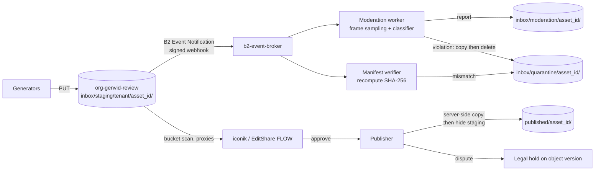
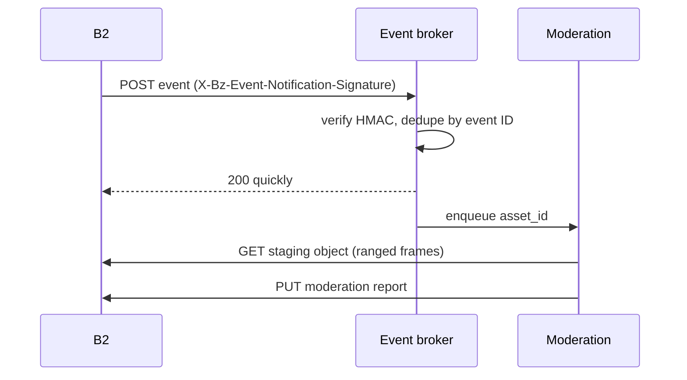

# Moderate, review and approve generated video before it is published

## Workload

Generated clips have to pass policy, brand and legal checks before release. Automated classification catches clear violations, a hash check confirms the asset matches its generation manifest, and editors review the rest in a media asset manager (MAM). Disputed assets must be preserved unchanged. Copying assets between moderation tools, a MAM and an archive creates divergent copies and breaks the audit trail.

B2 holds one copy per stage. The stage is expressed as a prefix in a single Object Lock-enabled bucket, so moderation, MAM and publishing all point at the same objects. Pre-approval stages sit under `inbox/` so one prefix-scoped key can cover them without reaching `published/`.

## Data flow

## B2 zones

One bucket, `<org>-genvid-review`, created with Object Lock enabled and **no default retention**, so normal stage transitions can delete. Legal hold is applied per object version when needed.

| Bucket | Prefix | Versioning / lifecycle | Object Lock | Purpose |
|---|---|---|---|---|
| `<org>-genvid-review` | `inbox/staging/<tenant>/<asset_id>/` | Lifecycle: delete hidden versions 7 days after hiding; current objects are never hidden by age ([example](../../examples/lifecycle-staging-hidden.json)) | Legal hold on dispute | New generations awaiting checks |
| `<org>-genvid-review` | `inbox/moderation/<asset_id>/` | Keep | Optional retention per object | Classifier reports and flagged crops |
| `<org>-genvid-review` | `inbox/quarantine/<asset_id>/` | Keep until case closed | Legal hold when disputed | Flagged assets; never reachable from CDN |
| `<org>-genvid-review` | `published/<asset_id>/` | Keep | Optional retention | Approved masters handed to [finishing and delivery](../finish-package-deliver-generated-video/architecture.md) |

S3 has no move: quarantine is a server-side copy followed by a delete of the staging object, and promotion is a server-side copy followed by hiding the staging object. A legal hold blocks deleting the held version, so apply holds after the copy. Do not reuse the age-based `scratch/` rule here: it would hide and delete assets still waiting for review.

## Boundaries

| Stays off B2 | Where it lives | Why |
|---|---|---|
| Moderation review queue and reviewer DB | Queue + relational DB | Workflow state |
| MAM metadata DBs | iconik / FLOW | The MAM indexes B2 objects; it does not replace them |
| Takedown ticketing | Ticketing system | Case management |
| Signing keys | KMS or HSM | Credentials |
| Event broker subscriber registry | Broker config store | Control plane |

## B2 capability map

| Capability | Used | How or why not |
|---|---|---|
| S3-compatible API | Yes | Workers and publisher |
| Presigned URLs | Yes | Reviewer access outside the MAM |
| CORS | No | Unless a custom review UI fetches media |
| Multipart upload | As needed | Long masters |
| Scoped application keys | Yes | One per stage role; see below |
| Event notifications | Yes | `b2:ObjectCreated:*` on `inbox/staging/` ([example](../../examples/event-notifications-staging.json)); enabled by Backblaze Support on request; at-least-once, signed ([reference guide](https://www.backblaze.com/docs/cloud-storage-event-notifications-reference-guide)) |
| Object versions | Yes | Implied by Object Lock |
| Lifecycle rules | Yes | Delete hidden `inbox/staging/` versions only ([example](../../examples/lifecycle-staging-hidden.json)) |
| SSE | Optional | SSE-B2 |
| Object Lock and legal hold | Yes | Legal hold on disputed versions |
| Server-side copy | Yes | Staging to published or quarantine |
| Cloud Replication | Optional | DR only |
| CDN / Overdrive | No | Delivery is the next architecture |

## Integration configuration

- **iconik (Backblaze guide).** Add a storage of type "Backblaze B2" with key ID, application key, bucket name, bucket ID and path. Enable Scan to build proxies ([guide](https://www.backblaze.com/docs/cloud-storage-integrate-iconik-with-backblaze-b2)). This uses B2 key ID and bucket ID rather than an S3 endpoint. A B2 key allows one prefix, so add one iconik storage per stage: `inbox/staging/` with `mam-staging-reader`, and `published/` with `mam-published-reader` if editors work there. A single whole-bucket read-only key is simpler but also exposes `inbox/quarantine/`.
- **EditShare FLOW (Backblaze guide).** Add a "Backblaze" storage with key ID, application key and bucket name ([guide](https://www.backblaze.com/docs/cloud-storage-integrate-editshare-flow-with-backblaze-b2)).
- **Event Notifications (B2 feature).** Configure rules with the native API ([`b2_set_bucket_notification_rules`](https://www.backblaze.com/apidocs/b2-set-bucket-notification-rules)); verify `X-Bz-Event-Notification-Signature`, acknowledge fast, and dedupe because delivery is at-least-once ([overview](https://www.backblaze.com/docs/cloud-storage-event-notifications), [reference guide](https://www.backblaze.com/docs/cloud-storage-event-notifications-reference-guide)). The [B2 Event Broker sample](https://github.com/backblaze-b2-samples/b2-event-broker) implements verify-and-fan-out on Cloudflare Workers.

For Frame.io, run the [Frame.io custom action sample](https://github.com/backblaze-b2-samples/backblaze-frameio), a bridge container that exports and imports assets between Frame.io and B2.

## Security

| Role | Bucket / prefix | Capabilities |
|---|---|---|
| generator-writer | `<org>-genvid-review` / `inbox/staging/` | `writeFiles` |
| moderator | `<org>-genvid-review` / `inbox/` (reads staging, writes moderation and quarantine; cannot reach `published/`) | `listFiles,readFiles,writeFiles,deleteFiles` |
| mam-staging-reader | `<org>-genvid-review` / `inbox/staging/` | `listFiles,readFiles` |
| mam-published-reader | `<org>-genvid-review` / `published/` | `listFiles,readFiles` |
| publisher | `<org>-genvid-review` (whole bucket: copy needs source and destination under one key) | `listFiles,readFiles,writeFiles` (hiding staging needs only `writeFiles`; no `deleteFiles`) |
| legal-hold-admin | `<org>-genvid-review` | `readFileLegalHolds,writeFileLegalHolds` |

Release legal holds only through an audited process. Takedown and erasure requests that start in the [curation architecture](../curate-video-training-corpus/architecture.md#takedown-and-erasure) follow the same audited path. Keep `inbox/quarantine/` private; no CDN or public path may reach this bucket.

## References

- [B2 Event Notifications](https://www.backblaze.com/docs/cloud-storage-event-notifications), [reference guide](https://www.backblaze.com/docs/cloud-storage-event-notifications-reference-guide) and [`b2_set_bucket_notification_rules`](https://www.backblaze.com/apidocs/b2-set-bucket-notification-rules)
- [`b2_hide_file`](https://www.backblaze.com/apidocs/b2-hide-file) (requires `writeFiles`)
- [B2 Object Lock](https://www.backblaze.com/docs/cloud-storage-object-lock)
- [B2 application keys](https://www.backblaze.com/docs/cloud-storage-application-keys)
- Samples: [B2 Event Broker](https://github.com/backblaze-b2-samples/b2-event-broker), [NudeNet Video Moderation](https://github.com/backblaze-b2-samples/nudenet-video-moderation), [Genblaze SDK](https://github.com/backblaze-labs/genblaze) (manifests to verify against), [Frame.io custom action](https://github.com/backblaze-b2-samples/backblaze-frameio)
