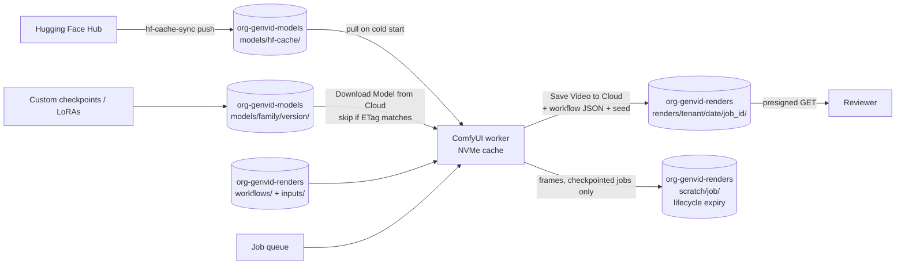

# Run a self-hosted open-weight video diffusion farm with shared weights and outputs

## Workload

A studio or platform runs open-weight video models (for example Wan, HunyuanVideo, LTX-Video) in ComfyUI on GPU instances that start and stop with demand, often across several GPU clouds. Each worker needs the same multi-GB checkpoints, VAEs, text encoders and LoRAs. Each job produces MP4 or WebM output that must outlive the worker and be shareable for review.

B2 is the shared model store and the durable output store. Worker NVMe is a cache, not a source of truth.

## Data flow

## B2 zones

| Bucket | Prefix | Versioning / lifecycle | Object Lock | Purpose |
|---|---|---|---|---|
| `<org>-genvid-models` | `models/hf-cache/` | Keep (content-addressed blobs and revision refs) | No retention applied | Mirrored Hugging Face cache |
| `<org>-genvid-models` | `models/<family>/<version>/` | Keep; new version = new prefix | Per-version retention when released | Custom checkpoints, VAEs, LoRAs with licence files |
| `<org>-genvid-renders` | `workflows/<name>/<version>.json`, `inputs/<tenant>/` | Keep | Not enabled | Versioned ComfyUI graphs and reference inputs |
| `<org>-genvid-renders` | `renders/<tenant>/<date>/<job_id>/` | Keep (or expire per tenant policy) | Not enabled | Output video, workflow JSON, seed |
| `<org>-genvid-renders` | `scratch/<job_id>/` | Lifecycle: hide, then delete ([example](../../examples/lifecycle-scratch.json)) | Not enabled | Intermediate frames |

## Boundaries

| Stays off B2 | Where it lives | Why |
|---|---|---|
| Hot weights | GPU VRAM and worker NVMe | Load latency; B2 is the cache's source |
| Job queue | Redis, SQS or Temporal | Transactional dispatch |
| User, session and billing DB | Relational DB | Application state |
| Scratch frames during a render | Worker disk | High-churn random I/O; only persisted to `scratch/` when a job is checkpointed |

## B2 capability map

| Capability | Used | How or why not |
|---|---|---|
| S3-compatible API | Yes | Nodes and hf-cache-sync use the S3 endpoint |
| Presigned URLs | Yes | Time-limited GET links for reviewers |
| CORS | Optional | Only if a browser app fetches renders with JavaScript ([example](../../examples/cors-playback.json)) |
| Large-file multipart upload | Yes | Multi-GB checkpoints pushed to `models/` |
| Scoped application keys | Yes | Read-only models key on workers; write key on renders |
| ETag on HEAD | Yes | Download node skips files whose local ETag matches; multipart ETags are not MD5s, so compare ETag to ETag, not to a local hash |
| Event notifications | No | Outputs are returned synchronously to the job |
| Object versions | Default | B2 keeps prior versions by default; versioned prefixes avoid rewrites, and a keep-latest rule ([example](../../examples/lifecycle-keep-latest.json)) cleans up any prefix whose keys are rewritten |
| Lifecycle rules | Yes | `scratch/` expiry |
| SSE | Optional | SSE-B2 default encryption |
| Object Lock / replication | Optional (released weights) | Lock a dedicated bucket for released custom weights if retention must be provable; upstream weights are reproducible, so add replication for DR only if they are not |
| Included egress / CDN | Indirect | Workers in other clouds pull weights; see [pricing](https://www.backblaze.com/cloud-storage/pricing) |
| Standard B2 vs Overdrive vs local cache | Standard + NVMe cache | ETag-validated NVMe cache absorbs repeats; Overdrive only if a large fleet cold-starts at once and measured throughput limits it |

## Integration configuration

- **ComfyUI Cloud Storage nodes (built-in B2 option).** Set `COMFY_S3_PROVIDER` to the Backblaze B2 preset and `COMFY_S3_REGION` to the bucket region; `COMFY_S3_ENDPOINT_URL` overrides the derived endpoint. Nodes cover Save Video to Cloud, image and audio input loading (there is no video load node), ETag-cached model download and presigned share URLs ([README](https://github.com/backblaze-labs/comfyui-cloud-storage)). Give the worker two keys if the node supports it (read-only models, write renders); otherwise run the worker with the renders key and pre-pull models with a read-only key in an init step.
- **HF Cache Sync (built-in B2 option).** Set `B2_ENDPOINT`, `B2_BUCKET`, `B2_REGION`, `B2_APPLICATION_KEY_ID` and `B2_APPLICATION_KEY`, or the `storage.*` keys in `.hf-cache-sync.yaml`; `hf-cache-sync doctor` reports which source it used ([README](https://github.com/backblaze-labs/hf-cache-sync)). A CI job with a write key pushes; workers and CI pull with a read-only key.

Endpoint: `https://s3.<region>.backblazeb2.com`, derived from the bucket region.

## Security

| Role | Bucket / prefix | Capabilities |
|---|---|---|
| model-publisher (CI) | `<org>-genvid-models` / `models/` | `listFiles,readFiles,writeFiles` |
| worker-model-reader | `<org>-genvid-models` / `models/` | `listFiles,readFiles` |
| worker-render-writer | `<org>-genvid-renders` | `listFiles,readFiles,writeFiles` |
| share-signer | `<org>-genvid-renders` / `renders/` | `readFiles` |

Presigned URLs are bearer credentials; keep expiry short. Custom ComfyUI nodes run with whatever credentials are in the worker environment, so review third-party nodes before installing them. Respect each open-weight model's licence for hosted use and keep it next to the weights.

## References

- [B2 S3 presigned URLs](https://www.backblaze.com/docs/cloud-storage-s3-compatible-api)
- [B2 lifecycle rules](https://www.backblaze.com/docs/cloud-storage-lifecycle-rules)
- [B2 application keys](https://www.backblaze.com/docs/cloud-storage-application-keys)
- Samples: [ComfyUI Cloud Storage nodes](https://github.com/backblaze-labs/comfyui-cloud-storage), [HF Cache Sync](https://github.com/backblaze-labs/hf-cache-sync), [Awesome Video Generation](https://github.com/backblaze-labs/awesome-video-generation)
