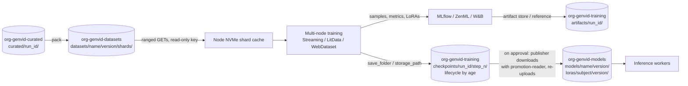
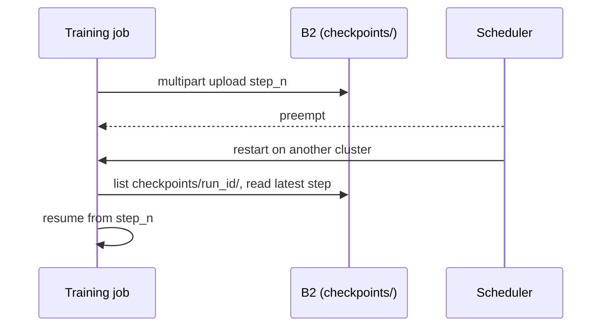

# Stream video shards into distributed diffusion training and version checkpoints and LoRAs

## Workload

Video diffusion transformers train on curated clips or on precomputed VAE latents and text embeddings. Training spans many GPUs, often across neocloud providers, and is preempted. Each run emits periodic multi-GB checkpoints, LoRA adapters, sample clips and eval metrics. Released weights must trace back to a dataset version and run.

B2 holds versioned shards, checkpoints, artifacts and promoted weights. It is reachable from every cluster through one S3 endpoint, so moving compute does not mean moving data.

## Data flow

## B2 zones

| Bucket | Prefix | Versioning / lifecycle | Object Lock | Purpose |
|---|---|---|---|---|
| `<org>-genvid-datasets` | `datasets/<name>/<version>/shards/` + `index.json` | New version = new prefix; never rewritten | Optional | WebDataset tars, MDS or LitData chunks |
| `<org>-genvid-training` | `checkpoints/<run_id>/step_<n>/` | Lifecycle: hide after N days, then delete ([example](../../examples/lifecycle-checkpoints.json)) | Not enabled | Resumable checkpoints |
| `<org>-genvid-training` | `artifacts/<run_id>/` | Keep | Not enabled | MLflow artifacts, sample MP4 grids, eval metrics |
| `<org>-genvid-models` | `models/<name>/<version>/`, `loras/<subject>/<version>/` | Keep | Per-object governance retention for released weights; no bucket default | Promoted weights read by inference |

B2 lifecycle rules act on prefix and age (`daysFromUploadingToHiding`, `daysFromHidingToDeleting`); they cannot keep the last K checkpoints. Promote keepers to `models/` (download and re-upload, see Security) before the expiry window, or exclude a run by giving it a prefix with no rule.

## Boundaries

| Stays off B2 | Where it lives | Why |
|---|---|---|
| Shard cache and shuffle buffers | Node NVMe / RAM | Random access during an epoch |
| In-memory checkpoint staging, NCCL state | GPU host memory | Transient |
| Experiment-tracking backend DB | MLflow / ZenML / W&B backend | Queryable metadata; bytes go to B2 |
| Scheduler and job queue | Slurm, Kubernetes, Ray | Control plane |
| Dataset registry DB | Relational DB | Maps versions to runs; points at B2 prefixes |

## B2 capability map

| Capability | Used | How or why not |
|---|---|---|
| S3-compatible API | Yes | Concurrent ranged GETs from many workers |
| Presigned URLs / CORS | No | All access is server-side with keys |
| Large-file multipart upload | Yes | Multi-GB checkpoints and shards |
| Scoped application keys | Yes | Read-only shard key, checkpoint writer, publisher |
| Event notifications | No | Promotion is an explicit pipeline step |
| Object versions | Default | B2 keeps prior versions of any rewritten key; versioned prefixes avoid rewrites, and the models bucket keeps versions for Object Lock |
| Lifecycle rules | Yes | Age-based expiry on `checkpoints/` |
| Server-side copy | No | Checkpoints and released weights live in different buckets, and a [CopyObject](https://www.backblaze.com/apidocs/s3-copy-object) runs under one key that must read the source and write the destination; promotion downloads and re-uploads instead |
| SSE | Optional | SSE-B2 default encryption |
| Object Lock | Optional | Separate models bucket for released weights ([example](../../examples/object-lock-governance.json)) |
| Cloud Replication | Optional | DR copy of the models bucket |
| Included egress / compute partners | Yes | Training clusters in other clouds read B2 directly; see [pricing](https://www.backblaze.com/cloud-storage/pricing) |
| Standard B2 vs Overdrive vs local cache | Standard + NVMe cache | Benchmark shard size and worker count against B2 first (the [WebDataset streaming sample](https://github.com/backblaze-b2-samples/webdataset-streaming-pytorch-training) reports live throughput); consider [Overdrive](https://www.backblaze.com/cloud-storage/b2-overdrive) when sustained multi-node read throughput is the measured bottleneck |

## Integration configuration

Endpoint everywhere: `https://s3.<region>.backblazeb2.com`, derived from `B2_REGION`.

- **MosaicML Streaming (built-in B2 option).** Set `S3_ENDPOINT_URL` to the B2 endpoint and the application key as `AWS_ACCESS_KEY_ID` / `AWS_SECRET_ACCESS_KEY`; the [cloud-credential guide](https://docs.mosaicml.com/projects/streaming/en/stable/how_to_guides/configure_cloud_storage_credentials.html) gives the Backblaze template. Use `remote=s3://<org>-genvid-datasets/datasets/<name>/<version>/` and a node-local `local` cache.
- **Lightning LitData (S3 custom endpoint).** Pass `storage_options={"S3_ENDPOINT_URL": ...}` (or the boto3 `endpoint_url`) to both `optimize` and `StreamingDataset` ([README](https://github.com/Lightning-AI/litData)).
- **Ray Train (built-in B2 option).** Set `storage_path="s3://<org>-genvid-training/checkpoints?endpoint_override=https://s3.<region>.backblazeb2.com"`, or set `AWS_ENDPOINT_URL_S3` with the application key in `AWS_ACCESS_KEY_ID` / `AWS_SECRET_ACCESS_KEY`, as the Backblaze B2 section of the [persistent-storage guide](https://docs.ray.io/en/latest/train/user-guides/persistent-storage.html) shows.
- **Composer (S3 custom endpoint).** Set `S3_ENDPOINT_URL` to the B2 endpoint and `save_folder="s3://<org>-genvid-training/checkpoints/<run_id>"`; Composer writes locally, then uploads, and `load_path` resumes from remote ([checkpointing docs](https://docs.mosaicml.com/projects/composer/en/stable/trainer/checkpointing.html)).
- **MLflow (built-in B2 option).** Set the artifact root to `b2://<bucket>@s3.<region>.backblazeb2.com/<path>` with the application key in `AWS_ACCESS_KEY_ID` / `AWS_SECRET_ACCESS_KEY` and `AWS_DEFAULT_REGION` set to the bucket region ([artifact-store docs](https://mlflow.org/docs/latest/self-hosting/architecture/artifact-store/)). Use an application key, not the master key. `s3://` with `MLFLOW_S3_ENDPOINT_URL` also works.
- **ZenML (built-in B2 option).** Run `zenml integration install b2` and register an artifact store with `--flavor=b2`, `--path=s3://<org>-genvid-training/artifacts/` and `endpoint_url` for the bucket region in `client_kwargs` ([ZenML B2 artifact store](https://docs.zenml.io/stacks/stack-components/artifact-stores/b2), [Backblaze guide](https://www.backblaze.com/docs/cloud-storage-use-backblaze-b2-as-an-artifact-store-with-zenml)). Credentials come from `B2_APPLICATION_KEY_ID` / `B2_APPLICATION_KEY` or a ZenML secret; scope the key to that prefix.
- **W&B reference artifacts (built-in B2 option).** Set `AWS_S3_ENDPOINT_URL` to the B2 endpoint and log `s3://` references to shards and checkpoints so W&B tracks them without copying bytes ([track external files](https://docs.coreweave.com/guides/artifacts/track-external-files/)).

Open-Sora, Wan, HunyuanVideo, FastVideo and finetrainers train from local paths: feed them through the streaming loaders above, or stage data and pull checkpoints with rclone.

## Security

| Role | Bucket / prefix | Capabilities |
|---|---|---|
| shard-packer | `<org>-genvid-datasets` / `datasets/` | `listFiles,readFiles,writeFiles` |
| trainer-reader | `<org>-genvid-datasets` / `datasets/<name>/` | `listFiles,readFiles` |
| checkpoint-writer | `<org>-genvid-training` | `listFiles,readFiles,writeFiles,deleteFiles` |
| promotion-reader | `<org>-genvid-training` / `checkpoints/` | `listFiles,readFiles` (held by the publisher) |
| model-publisher | `<org>-genvid-models` | `listFiles,readFiles,writeFiles,writeFileRetentions` |
| inference-reader | `<org>-genvid-models` / `models/` | `listFiles,readFiles` |

Inject keys through the cluster secret store; never in job specs, logged configs or W&B run config. Promotion crosses buckets: the publisher downloads with the read-only `promotion-reader` key and re-uploads with `model-publisher`, verifying size and checksum after upload. Released weights use per-object retention in the models bucket. Enabling Object Lock alone does not retain objects; leave cached weights without retention and keep checkpoint pruning independent of release retention. Do not hand the publisher an unrestricted key for convenience.

## References

- [B2 lifecycle rules](https://www.backblaze.com/docs/cloud-storage-lifecycle-rules)
- [B2 large files](https://www.backblaze.com/docs/cloud-storage-large-files)
- [B2 S3-compatible API](https://www.backblaze.com/docs/cloud-storage-s3-compatible-api)
- [B2 Overdrive](https://www.backblaze.com/cloud-storage/b2-overdrive)
- Samples: [WebDataset Streaming PyTorch Training](https://github.com/backblaze-b2-samples/webdataset-streaming-pytorch-training), [LoRA Training Studio](https://github.com/backblaze-b2-samples/lora-training-studio)
